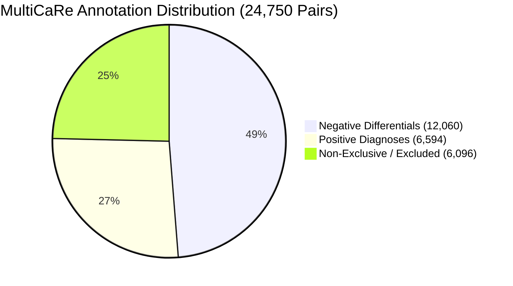
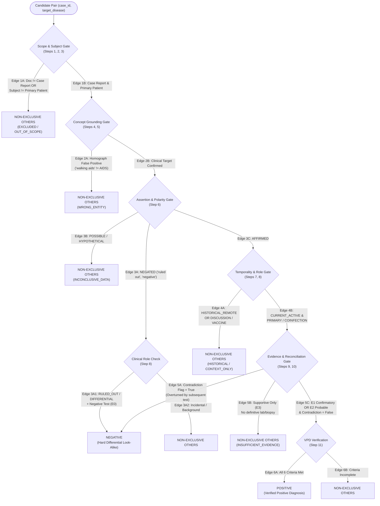

# MultiCaRe Clinical Dataset & Multi-Agent Annotation Pipeline

> **Branch:** `nguyenkhoa-llm-labeling`  
> **Repository:** [HealthCareAgent](https://github.com/Quanninh/HealthCareAgent)  
> **Clinical Scope:** 29 Target Diseases across 3 Cohorts (Core Reference, Dual-Track, Diagnostic Conundrums)  
> **Standardized SOAP Dataset:** 3,289 Populated Cases via **Argon 4** (LOINC 81218-0)  

---

## 1. Overview & Problem Formulation

Standard NLP classification often treats medical case reports as having a single exclusive diagnosis ("winner-take-all"). In real-world clinical care, however, patients frequently present with coinfections, secondary opportunistic infections, or complex differential diagnoses.

This repository formulates disease identification at the **Pair-Level** `(case_id, target_disease)` and implements a clinically grounded **Coordinator + 29 Specialized Disease Agents** framework across the full MultiCaRe corpus (~98,000 clinical cases extracted from PMC case reports).

### Core Highlights:
- **Zero Lossless Corpus:** Exactly **24,750 candidate pairs** and **24,750 annotated records** across **29 diseases** (100% parity).
- **Evidence-Grounded Partitioning:** Annotated records partitioned into **POSITIVE** (6,594), **NEGATIVE** (12,060), and **NON-EXCLUSIVE OTHERS** (6,096).
- **Standardized SOAP Dataset (Argon 4):** Exactly **3,289 fully populated clinical case reports** structured into the 8-field LOINC 81218-0 / Boston University write-up schema with 100% anti-leakage compliance under a 3 POS : 2 NEG quality-ranked ratio.
- **Unified Package & CLI:** Powered by `clinical_data` (Python 3.10+ package) and the `clinical-data` CLI command with 77 automated pytest suites passing.

---

## 2. Clean Dataset Architecture

The repository adheres to the **Clean Dataset Architecture** (`/swe` modularity principles), separating core data pipelines, operational engines, configuration assets, and auxiliary artifacts:

```text
codebases/data_processing/
├── pyproject.toml                # Package configuration & CLI entry points
├── master_manifest.json          # Single Source of Truth (SSOT) covering all 29 diseases
│
├── data/                         # TẦNG DỮ LIỆU (Clean 3-Stage Pipeline)
│   ├── candidates/               # 29 files input_<slug>.jsonl (24,750 candidate pairs)
│   ├── annotated/                # 29 files output_<slug>.jsonl partitioned into:
│   │   ├── positive/             # 6,594 POS records (29 files)
│   │   ├── negative/             # 12,060 NEG records (29 files)
│   │   └── non-exclusive_others/ # 6,096 OTHER records (29 files, symlink alias: others/)
│   └── soap/                     # 3,289 clinical cases structured by Argon 4 (29 folders)
│       └── manifest.json         # SOAP dataset manifest with Argon-4 provenance
│
├── src/clinical_data/            # TẦNG MÃ NGUỒN (Core Package & Unified CLI)
│   ├── candidates/               # Retrieval, BM25 boundary gate, and extraction engines
│   ├── curation/                 # Asset builders, prompt templates, and skills generator
│   ├── soap/                     # LOINC 81218-0 SOAP exporter and structuring logic
│   ├── timeslicing/              # Longitudinal timeline slicers (T0/T1/T2) & evaluators
│   ├── validation/               # Master, Clinical Gate, SOAP Anti-Leakage, Record validators
│   └── cli.py                    # Unified CLI dispatch (`clinical-data`)
│
├── tests/                        # TẦNG KIỂM THỬ (80 test items: 77 passed, 3 skipped, 0 failures)
├── scripts/                      # Facade scripts for direct command-line execution
│
├── resources/                    # GOM CÁC TÀI NGUYÊN CẤU HÌNH & QUY CHUẨN LÂM SÀNG
│   ├── config/                   # disease_taxonomy.json, master_disease_taxonomy.json, syndromes_criteria.md
│   ├── protocols/                # 4 Clinical Protocols (Ontology, Schema, Matrix, 12-Step Protocol)
│   └── prompts/                  # Clinical prompt directives:
│       ├── clinical/             # 30 files (1 master batch directive + 29 disease prompts)
│       └── soap/                 # soap_structuring_prompt.md (Argon 4 extraction directive)
│
├── artifacts/                    # GOM CÁC PHẦN PHỤ TRỢ (Không để loose files ở root)
│   ├── logs/                     # Execution logs grouped by cohorts/ and runs/
│   ├── reports/                  # Summaries (funnels, trees) and audits (matrices, provenance)
│   └── docs/                     # 12_step_protocols.md, milestones, guidelines
│
└── .agents/skills/               # Agent skill specifications (31 skills: Coordinator + 29 Diseases + SOAP)
```

---

## 3. Global Dataset Statistics & Cohort Breakdown

All 24,750 candidate pairs across all 29 target diseases were annotated, audited, and partitioned into **Verified POSITIVE** (6,594), **Verified NEGATIVE** (12,060), and **NON-EXCLUSIVE OTHERS** (6,096) via the **12-Step Clinical Annotation Protocol** detailed in [Section 4](#4-the-12-step-clinical-annotation-engine).

### 3.1 Global Dataset Metrics (Master Manifest)

| Metric | Count | Percentage | Description / Storage Path |
|:---|:---:|:---:|:---|
| **Total Target Diseases** | **29** | 100.0% | Classified into Core (15), Dual-Track (10), Conundrums (4) |
| **Total Candidate Pairs** | **24,750** | 100.0% | Input candidate pairs under `data/candidates/input_<slug>.jsonl` |
| **Total Annotated Pairs** | **24,750** | 100.0% | 100% annotation completion (0 unannotated pairs) |
| ├── **POSITIVE** | **6,594** | 26.64% | Confirmed disease cases (`data/annotated/positive/`) |
| ├── **NEGATIVE** | **12,060** | 48.73% | Verified negative / ruled-out differentials (`data/annotated/negative/`) |
| └── **NON-EXCLUSIVE OTHERS** | **6,096** | 24.63% | Inconclusive data or non-case reports (`data/annotated/non-exclusive_others/`) |
| **SOAP Dataset (Argon 4)** | **3,289** | 100.0% | Fully populated 8-field clinical notes (`data/soap/`) |

---

### 3.2 Breakdown by Disease Cohort



| Cohort | Diseases | Candidate Pairs | Verified POS | Verified NEG | Excluded / Other | Annotator Model |
|:---|:---:|:---:|:---:|:---:|:---:|:---|
| **Core Reference** | 15 | 17,431 | 4,601 | 8,024 | 4,806 | `gemini-3.8-flash` |
| **Dual-Track** | 10 | 2,466 | 1,049 | 915 | 502 | `gemini-3.8-flash` |
| **Diagnostic Conundrums** | 4 | 4,853 | 944 | 3,121 | 788 | `argon-4` |
| **Total** | **29** | **24,750** | **6,594** | **12,060** | **6,096** | *(Hybrid Multi-Model)* |

---

### 3.3 Detailed 29-Disease Distribution Table

All figures are strictly synchronized with [`master_manifest.json`](master_manifest.json) and verified by [`scripts/validate_master.py`](scripts/validate_master.py):

| # | Disease Slug | Display Name | Cohort | Candidates | POS | NEG | Other | Annotator Model |
|:---:|:---|:---|:---:|:---:|:---:|:---:|:---:|:---|
| 1 | `amoebiasis` | Amoebiasis | Dual-Track | 83 | 25 | 41 | 17 | `gemini-3.8-flash` |
| 2 | `aspergillosis` | Aspergillosis | Dual-Track | 801 | 342 | 281 | 178 | `gemini-3.8-flash` |
| 3 | `brucellosis` | Brucellosis | Core Reference | 473 | 114 | 248 | 111 | `gemini-3.8-flash` |
| 4 | `chikungunya` | Chikungunya | Core Reference | 62 | 21 | 29 | 12 | `gemini-3.8-flash` |
| 5 | `cholera` | Cholera | Core Reference | 49 | 7 | 11 | 31 | `gemini-3.8-flash` |
| 6 | `covid_19` | COVID-19 | Core Reference | 4,359 | 1,933 | 346 | 2,080 | `gemini-3.8-flash` |
| 7 | `cryptococcosis` | Cryptococcosis | Dual-Track | 483 | 170 | 254 | 59 | `gemini-3.8-flash` |
| 8 | `cytomegalovirus` | Cytomegalovirus (CMV) | Conundrum | 2,585 | 411 | 2,002 | 172 | `argon-4` |
| 9 | `dengue` | Dengue | Core Reference | 356 | 121 | 161 | 74 | `gemini-3.8-flash` |
| 10 | `ebola_filovirus` | Ebola Filovirus | Core Reference | 202 | 3 | 1 | 198 | `gemini-3.8-flash` |
| 11 | `echinococcosis` | Echinococcosis | Dual-Track | 360 | 229 | 71 | 60 | `gemini-3.8-flash` |
| 12 | `histoplasmosis` | Histoplasmosis | Dual-Track | 293 | 83 | 161 | 49 | `gemini-3.8-flash` |
| 13 | `hiv_aids` | HIV / AIDS | Core Reference | 5,735 | 1,069 | 4,029 | 637 | `gemini-3.8-flash` |
| 14 | `leishmaniasis` | Leishmaniasis | Core Reference | 240 | 122 | 76 | 42 | `gemini-3.8-flash` |
| 15 | `leprosy` | Leprosy (Hansen) | Dual-Track | 121 | 66 | 33 | 22 | `gemini-3.8-flash` |
| 16 | `leptospirosis` | Leptospirosis | Core Reference | 218 | 50 | 138 | 30 | `gemini-3.8-flash` |
| 17 | `lymphatic_filariasis` | Lymphatic Filariasis | Dual-Track | 40 | 17 | 7 | 16 | `gemini-3.8-flash` |
| 18 | `malaria` | Malaria | Core Reference | 938 | 132 | 238 | 568 | `gemini-3.8-flash` |
| 19 | `melioidosis` | Melioidosis | Dual-Track | 55 | 41 | 12 | 2 | `gemini-3.8-flash` |
| 20 | `neurocysticercosis` | Neurocysticercosis | Dual-Track | 138 | 54 | 53 | 31 | `gemini-3.8-flash` |
| 21 | `nocardiosis` | Nocardiosis | Conundrum | 204 | 136 | 36 | 32 | `argon-4` |
| 22 | `pneumocystis` | Pneumocystis (PJP/PCP) | Conundrum | 665 | 106 | 132 | 427 | `argon-4` |
| 23 | `rabies` | Rabies | Core Reference | 62 | 3 | 9 | 50 | `gemini-3.8-flash` |
| 24 | `schistosomiasis` | Schistosomiasis | Dual-Track | 92 | 47 | 22 | 23 | `gemini-3.8-flash` |
| 25 | `syphilis` | Syphilis (The Masquerader) | Conundrum | 1,399 | 193 | 1,069 | 137 | `argon-4` |
| 26 | `tuberculosis` | Tuberculosis (TB) | Core Reference | 4,468 | 1,042 | 2,481 | 945 | `gemini-3.8-flash` |
| 27 | `typhoid_fever` | Typhoid Fever | Core Reference | 166 | 34 | 86 | 46 | `gemini-3.8-flash` |
| 28 | `yellow_fever` | Yellow Fever | Core Reference | 27 | 3 | 9 | 15 | `gemini-3.8-flash` |
| 29 | `zika` | Zika | Core Reference | 76 | 20 | 24 | 32 | `gemini-3.8-flash` |
| **Total** | **29 Diseases** | **All Cohorts** | — | **24,750** | **6,594** | **12,060** | **6,096** | — |

---

## 4. The 12-Step Clinical Annotation Engine

All 24,750 candidate pairs in this dataset were labeled under the **12-Step Clinical Annotation Protocol** defined in [`resources/protocols/04_gold_standard_annotation_protocol.md`](resources/protocols/04_gold_standard_annotation_protocol.md). The pipeline formalizes disease annotation as **Biomedical Claim Verification** governed by the foundational epistemic axiom:

$$\text{MENTION} \neq \text{EVIDENCE} \neq \text{CLAIM} \neq \text{LABEL}$$

---

### 4.1 Annotated Record Schema Overview

Each annotated record in `data/annotated/{positive,negative,non-exclusive_others}/output_<slug>.jsonl` encapsulates the full 12-step provenance and character-span evidence:

```json
{
  "pair_id": "PMC7439188_01::Amoebiasis",
  "case_id": "PMC7439188_01",
  "target_disease": "Amoebiasis",
  "decision": "POSITIVE | NEGATIVE | INCONCLUSIVE_DATA",
  "rationale": "...",
  "step1_document_type": "CLINICAL_CASE_REPORT",
  "step2_ccu_type": "PRIMARY_CARE_EPISODE",
  "step3_patient_anchor": {
    "anchor_type": "PRIMARY_PATIENT",
    "age": 50.0,
    "gender": "Male"
  },
  "step4_condition_matched": "Amoebiasis",
  "step5_concept_grounding": "TARGET_CONFIRMED",
  "step6_assertion_type": "AFFIRMED",
  "step7_temporality": "CURRENT_ACTIVE",
  "step8_clinical_role": "PRIMARY_DIAGNOSIS",
  "step9_evidence_strength": "E1_DISEASE_SPECIFIC_CONFIRMATORY",
  "step9_key_evidence": {
    "evidence_items": [
      {
        "source_quote": "Pathogenic Entamoebae trophozoites were recognized by the presence of phagocytosed ingested intracellular red cells.",
        "start_char": 3288,
        "end_char": 3404,
        "test_name": "Histopathology with erythrophagocytosis",
        "strength": "E1_CONFIRMATORY"
      }
    ]
  },
  "step10_contradiction_flag": false,
  "step11_vpd_satisfied": true,
  "step12_dataset_label": "POSITIVE"
}
```

---

### 4.2 Step Options & Decision Routing Matrix

The table below details all 12 steps, their permitted schema options (enums), their routing destinations (`POSITIVE`, `NEGATIVE`, `OTHERS`), and edge condition logic:

| Step | Protocol Step | Available Options (Schema Enums) | Decision Routing | Edge Transition Logic |
|:---:|:---|:---|:---:|:---|
| **1** | `document_type` | `CLINICAL_CASE_REPORT`<br>`CASE_SERIES`<br>`REVIEW_ARTICLE`<br>`CLINICAL_TRIAL`<br>`ANIMAL_STUDY` | Continue → Step 2<br>Branch → **OTHERS** | **Edge 1A:** Only individual human patient cases proceed; reviews, clinical trials ($n=100$), and animal studies exit to `EXCLUDED`. |
| **2** | `ccu_type` | `PRIMARY_CARE_EPISODE`<br>`SPLIT_CASE_SERIES`<br>`AGGREGATED_COHORT` | Continue → Step 3<br>Branch → **OTHERS** | **Edge 1A:** Multi-patient case series are split into atomic patient units; non-separable aggregate cohorts exit to `EXCLUDED`. |
| **3** | `patient_anchor` | `PRIMARY_PATIENT`<br>`FAMILY_MEMBER`<br>`DONOR`<br>`HEALTHCARE_WORKER` | Continue → Step 4<br>Branch → **OTHERS** | **Edge 1A:** Attributes must belong to the primary patient; maternal carrier or donor history exits to `EXCLUDED`. |
| **4** | `condition_matched` | `TargetDiseaseMatched`<br>`Unmatched` | Continue → Step 5<br>Branch → **OTHERS** | Verifies text span contains lexical match for target disease taxonomy. |
| **5** | `concept_grounding` | `TARGET_CONFIRMED`<br>`TARGET_RULED_OUT`<br>`TARGET_SUSPECTED`<br>`HOMOGRAPH_FALSE_POSITIVE` | Continue → Step 6<br>Branch → **OTHERS** | **Edge 2A:** Lexical false cognates (*walking aids* $\neq$ AIDS, *patent foramen ovale* $\neq$ *P. ovale*) exit to `WRONG_ENTITY`. |
| **6** | `assertion_type` | `AFFIRMED`<br>`NEGATED`<br>`POSSIBLE_HYPOTHETICAL`<br>`CONDITIONAL` | Branch → **POSITIVE**<br>Branch → **NEGATIVE**<br>Branch → **OTHERS** | **Edge 3A/3C:** `NEGATED` routes toward negative differential verification. `AFFIRMED` proceeds to temporality gate. `POSSIBLE` routes to `INCONCLUSIVE_DATA`. |
| **7** | `temporality` | `CURRENT_ACTIVE`<br>`HISTORICAL_REMOTE`<br>`FUTURE_PLANNED` | Continue → Step 8<br>Branch → **OTHERS** | **Edge 4A:** Remote childhood infections or historical exposures exit to `HISTORICAL_ONLY`. Only active presenting illness proceeds. |
| **8** | `clinical_role` | `PRIMARY_DIAGNOSIS`<br>`CONFIRMED_COINFECTION`<br>`RULED_OUT_DIAGNOSIS`<br>`DIFFERENTIAL_DIAGNOSIS`<br>`PREVENTION`<br>`BACKGROUND_DISCUSSION` | Continue → Step 9<br>Branch → **NEGATIVE**<br>Branch → **OTHERS** | **Edge 3A1:** If Step 6 = `NEGATED` and Role = `RULED_OUT_DIAGNOSIS` → **NEGATIVE** (Hard look-alike). If Role = `PRIMARY_DIAGNOSIS` → proceed to Evidence Gate. |
| **9** | `evidence_strength` | `E1_CONFIRMATORY` (culture, PCR, biopsy)<br>`E2_STRONG_PROBABLE` (serology, imaging)<br>`E3_SUPPORTIVE_NON_SPECIFIC` (fever, WBC)<br>`E0_CONTRADICTED` (negative lab test) | Continue → Step 10<br>Branch → **NEGATIVE**<br>Branch → **OTHERS** | **Edge 5B/5C:** Only $E_1$ or $E_2$ can support a positive diagnosis. $E_3$ alone exits to `INSUFFICIENT_EVIDENCE`. $E_0$ confirms `NEGATIVE`. |
| **10** | `contradiction_flag` | `false` (no unresolved conflict)<br>`true` (overturned by subsequent test) | Continue → Step 11<br>Branch → **NEGATIVE** | **Edge 5A:** Presumptive working diagnoses overturned by subsequent negative PCR/biopsy are resolved to `NEGATIVE` or `OTHERS`. |
| **11** | `vpd_satisfied` | `true`<br>`false` | Branch → **POSITIVE**<br>Branch → **NEG / OTHERS** | **Edge 6A:** Valid Positive Diagnosis holds iff `AFFIRMED` ∧ `CURRENT` ∧ `PRIMARY/COIN` ∧ (`E1` ∨ `E2`) ∧ (`contradiction = False`). |
| **12** | `dataset_label` | `POSITIVE`<br>`NEGATIVE`<br>`NON-EXCLUSIVE OTHERS` | Final Dataset Partition | Serializes audit record with character-span verification (`case_text[start:end] == quote`). |

---

### 4.3 Decision Routing Tree & State Machine

Synthesizing the options above, the protocol operates as an explicit **Branching Decision State Machine**. Every edge defines a strict condition routing cases toward `POSITIVE`, `NEGATIVE`, or `NON-EXCLUSIVE OTHERS`:



---

### 4.4 Epistemic Literature Grounding: Verbatim Citations for All 12 Steps

To ensure complete scientific defensibility, every step of the annotation protocol is directly grounded in peer-reviewed literature stored in [`literature/`](literature/), cited below verbatim:

* **Step 1: Document Type Verification (`document_type`)**  
  *Nievas Offidani & Delrieux (Data in Brief 2024, PMC10797379; [`Dataset_of_Clinical_Case_PubMedpdf.pdf`](literature/05_clinical_coreference_ccu/ccu_paper_llm/Dataset_of_Clinical_Case_PubMedpdf.pdf)):*
  > *"Although PMC contains millions of open-access biomedical articles, extracting clinical cases is non-trivial... Many articles tagged as case reports are actually case series, reviews, or clinical trials... without document filtering, non-patient data contaminates the corpus."*

* **Step 2: Clinical Case Unit Disentanglement (`ccu_type`)**  
  *Gagnier et al. (CARE Guidelines, Ann Intern Med 2013, PMC3833570; [`CARE_Guidelines_PMC3833570.xml`](literature/01_medical_rag_clinical_llms/CARE_Guidelines_PMC3833570.xml)):*
  > *"The primary unit of reporting in a case report is the individual patient encounter, presenting the clinical story in a timeline format from initial presentation to outcome."*

* **Step 3: Subject & Coreference Resolution (`patient_anchor`)**  
  *Harkema et al. (ConText Algorithm, JBI 2009; [`02_Harkema2009_ConText.pdf`](literature/02_entity_hijacking_negation/02_Harkema2009_ConText.pdf)):*
  > *"A query for patients with a diagnosis of pneumonia may return false positive records for which pneumonia is mentioned but is negated (e.g., 'ruled out pneumonia'), experienced by a family member (e.g., 'family history of pneumonia'), or occurred in the past ('past history of pneumonia')."*  
  *Salem et al. (BIOCOREF, arXiv 2025; [`BIOCOREF.pdf`](literature/05_clinical_coreference_ccu/ccu_paper/BIOCOREF.pdf)):*
  > *"Biomedical coreference resolution is critical for clinical extraction because patient attributes, historical conditions, and familial traits are frequently introduced through complex anaphoric chains that mislead surface-level classifiers."*

* **Step 4: Disease Mention Boundary Identification (`condition_matched`)**  
  *Kennedy et al. (npj Digital Medicine 2019; [`09_Kennedy2019_FalsePositiveDisease.pdf`](literature/02_entity_hijacking_negation/09_Kennedy2019_FalsePositiveDisease.pdf)):*
  > *"A simple search for disease names in clinical notes yields high false-positive rates because disease terms frequently appear in non-affirmative contexts, such as differential diagnoses, screening tests, or negative mentions."*

* **Step 5: Concept Grounding & Homograph Disambiguation (`concept_grounding`)**  
  *Shi et al. (DI++, Artificial Intelligence in Medicine 2022; [`10_Shi2022_DI_PlusPlus.pdf`](literature/02_entity_hijacking_negation/10_Shi2022_DI_PlusPlus.pdf)):*
  > *"Condition identification must be decoupled into mention extraction and mention classification to prevent candidate diagnoses and literature discussion from being conflated with actual patient conditions."*

* **Step 6: Syntactic Assertion & Negation Scope (`assertion_type`)**  
  *Chapman et al. (NegEx, JBI 2001; [`01_Chapman2001_NegEx.pdf`](literature/02_entity_hijacking_negation/01_Chapman2001_NegEx.pdf)):*
  > *"In clinical reports the presence of a term does not necessarily indicate the presence of the clinical condition represented by that term. In fact, many of the most frequently described findings and diseases in discharge summaries, radiology reports, history and physical exams, and other transcribed reports are denied in the patient."*  
  *Uzuner et al. (2010 i2b2/VA Challenge, JAMIA 2011; [`03_Uzuner2011_i2b2_VA_Assertion.pdf`](literature/02_entity_hijacking_negation/03_Uzuner2011_i2b2_VA_Assertion.pdf)):*
  > *"Clinical assertions must distinguish between conditions that are present, absent, possible, conditional, hypothetical, or associated with someone else."*

* **Step 7: Temporal Status Tracking (`temporality`)**  
  *Harkema et al. (ConText Algorithm, JBI 2009; [`02_Harkema2009_ConText.pdf`](literature/02_entity_hijacking_negation/02_Harkema2009_ConText.pdf)):*
  > *"Temporality determines whether the clinical condition is current, historical, or hypothetical... distinguishing acute presenting illness from remote historical episodes."*

* **Step 8: Discourse Role & Look-Alike Adjudication (`clinical_role`)**  
  *Weller et al. (NevIR Benchmark, EACL 2024; [`13_Weller2024_NevIR.pdf`](literature/02_entity_hijacking_negation/13_Weller2024_NevIR.pdf)):*
  > *"Pre-trained language models and neural retrieval models struggle significantly with negation, often retrieving documents that explicitly negate the query concept due to high lexical overlap."*

* **Step 9: Evidence Specificity Stratification (`evidence_strength`)**  
  *CDC MMWR Case Definitions (1997, 46(RR-10); [`16_CDC1997_CaseDefinitions_InfectiousConditions_MMWR.pdf`](literature/02_entity_hijacking_negation/16_CDC1997_CaseDefinitions_InfectiousConditions_MMWR.pdf)):*
  > *"A confirmed case must be laboratory confirmed by isolation of the pathogen, detection of pathogen-specific nucleic acid, or demonstration of a diagnostic antibody titer... Presumptive or supportive symptoms alone do not meet the criteria for a confirmed case."*

* **Step 10: Multi-Claim Trajectory Reconciliation (`contradiction_flag`)**  
  *Javaji et al. (CLAIM-BENCH, AACL 2025; [`01_Can_AI_Validate_Science_CLAIM_BENCH_AACL2025.pdf`](literature/04_llm_annotation_benchmarks/01_Can_AI_Validate_Science_CLAIM_BENCH_AACL2025.pdf)):*
  > *"Verifying claims in scientific literature demands explicit alignment between extracted assertions and concrete evidentiary spans rather than implicit generative recall... When conflicting assertions arise across a narrative, later definitive evidence must supersede initial working hypotheses."*

* **Step 11: Valid Positive Diagnosis (VPD) Verification Gate (`vpd_satisfied`)**  
  *Guyatt et al. (GRADE Working Group, BMJ 2008, PMC2335261; [`GRADE_Consensus_BMJ2008.txt`](literature/04_llm_annotation_benchmarks/GRADE_Consensus_BMJ2008.txt)):*
  > *"The quality of evidence reflects the extent to which our confidence in an estimate of the effect is adequate to support a particular recommendation... High quality evidence requires definitive confirmatory findings."*  
  *Communications Medicine (Nature Portfolio, 2025; [`22_Structured_Clinical_Approach_Explainable_Reasoning_CommsMed2025.pdf`](literature/04_llm_annotation_benchmarks/22_Structured_Clinical_Approach_Explainable_Reasoning_CommsMed2025.pdf)):*
  > *"Decomposing clinical reasoning into structured, explainable steps significantly improves diagnostic accuracy and alignment with clinician decision-making over direct end-to-end LLM generation."*

* **Step 12: Character-Span Audit & Traceability (`dataset_label`)**  
  *Zhang et al. (CliniFact, Nature Scientific Data 2025; [`06_CliniFact_Evaluating_Clinical_Research_Claims_SciData2025.pdf`](literature/04_llm_annotation_benchmarks/06_CliniFact_Evaluating_Clinical_Research_Claims_SciData2025.pdf)):*
  > *"Evaluating clinical research claims requires rigorous evidence grounding where model assertions must be directly mapped to source textual spans... to prevent hallucination and ensure reproducible adjudication."*

---

## 5. Standardized SOAP Clinical Dataset (Argon 4)

Located in [`data/soap/`](data/soap/), this dataset translates unstructured case narratives into high-quality clinical notes conforming to **LOINC 81218-0** (*Discharge summary - recommended C-CDA R2.1 sections*), the **Boston University School of Medicine write-up standard**, and the international **CARE Guidelines** (Gagnier et al., 2013). All 3,289 clinical cases across all 29 target diseases were curated and structured directly by **Argon 4 (`argon-4`)**.

---

### 5.1 Theoretical Foundation: Diagnostic Reasoning vs. Output Accuracy

In traditional medical NLP, benchmark datasets (e.g., MedQA, MMLU, MultiMedQA) evaluate only whether a model selects the correct multiple-choice token. As formulated by **Wu et al. (Stanford University, arXiv:2505.11733, 2025)**:

> *"Unlike domains like mathematics or coding, where the reasoning process is secondary to the correct answer, medical diagnoses require both the final diagnosis and the thought process to be defensible. In clinical practice, physicians need to articulate coherent rationales, which is important for ensuring informed consent, meeting the standard of care, facilitating documentation and billing, and enabling clinical collaboration... Mistakes or deficiencies in reasoning, even if the correct diagnosis is given, can risk case mismanagement."*

To train and evaluate models on defensible clinical reasoning rather than rote memorization, each case report in our dataset is structured to preserve the full diagnostic progression while preventing information contamination.

---

### 5.2 Quality Selection Criteria & Operational Implementation

Case selection and ranking are grounded in the clinician-developed quality dimensions from **Wu et al. (Stanford University, 2025)** and the narrative reporting standards of the **CARE Guidelines** (Gagnier et al., 2013). 

#### A. Academic Quality Dimensions
1. **Thoroughness of Case Presentation (Wu et al., 2025; CARE Items 5–6):**
   > *"Look for: HPI, past history, meds, allergies, vitals, focused exam, labs, imaging, hospital course, outcome."*  
   Cases with seriously deficient presentations (isolated summaries without vitals or exam) are systematically filtered out.
2. **Dependence on Integrative Clinical Reasoning (Wu et al., 2025):**
   > *"Measures need to combine >=2 data points (hx, labs, etc)... High: THREE+ clues; requires synthesis; Outstanding: stepwise, complex reasoning."*  
   Trivial cases with dead-giveaway symptoms that undermine multi-step differential reasoning are omitted.
3. **Explicit Differential Diagnosis & Plausible Alternatives (Wu et al., 2025; CARE Item 8):**
   > *">=2 plausible alternatives? If yes → 'Yes'; else → 'No'."*  
   Negative controls must represent true syndromic look-alikes formally investigated and ruled out during differential diagnosis.
4. **Transparency of Diagnostic Reasoning (Wu et al., 2025):**
   Cases must provide structured justification explaining why alternative conditions were considered and excluded based on objective diagnostic testing.

#### B. Operationalization in Code (Deterministic QRS Formulation)
In the original Stanford MedCaseReasoning pipeline, scoring was performed by prompting an external LLM (`o4-mini`) on a 1–5 scale. To ensure deterministic reproducibility, eliminate external API latency/costs, and leverage the pre-verified 12-step clinical annotations across all 24,750 candidates, the curation pipeline in [`src/clinical_data/curation/soap_exporter.py`](src/clinical_data/curation/soap_exporter.py) translates these principles into two deterministic piecewise mathematical scoring functions:

##### 1. Positive Quality Ranking Score ($Score_{POS}$)
For each candidate pair $c = (\text{ann}, \text{cand})$, $Score_{POS}(c) \in [-70, 100]$ optimizes for definitive microbiological/pathological confirmation combined with comprehensive clinical presentation:

$$Score_{POS}(c) = S_{\text{evidence}} + S_{\text{conf}} + S_{\text{length}} + S_{\text{image}} - P_{\text{contra}}$$

Where each constituent term is defined as follows:

| Term | Evaluation Dimension | Criteria & Value Assignment | Rationale / Clinical Target |
|:---|:---|:---|:---|
| **$S_{\text{evidence}}$** | Evidence Strength (`step9_evidence_strength`) | **+40** if `E1_CONFIRMATORY` (culture, PCR, biopsy)<br>**+25** if `E2_STRONG_PROBABLE` (serology, imaging)<br>**+10** if `E3_SUPPORTIVE_NON_SPECIFIC`<br>**0** otherwise | Rewards microbiological or histopathological confirmation |
| **$S_{\text{conf}}$** | Annotation Confidence (`confidence`) | **+30** if `HIGH`<br>**+15** if `MEDIUM`<br>**0** otherwise | Diagnostic certainty of extracted findings |
| **$S_{\text{length}}$** | Narrative Depth ($W = \text{word count}$) | **+20** if $400 \le W \le 1,500$<br>**+10** if $200 \le W < 400$ or $W > 2,500$<br>**-20** if $W < 200$ (penalizes truncated summaries) | Optimal documentation depth for teaching cases |
| **$S_{\text{image}}$** | Multimodal Anchor (`has_images`) | **+10** if clinical figures or imaging present (`True`)<br>**0** if text-only | Grounding in objective radiological/pathological visuals |
| **$P_{\text{contra}}$** | Contradiction Penalty (`step10_contradiction_flag`) | **-50** if contradiction flagged (`True`)<br>**0** if no unresolved contradictions | Severe penalty for conflicting or overturned claims |

---

##### 2. Negative Quality Ranking Score ($Score_{NEG}$ — Hard Look-Alikes)
For negative controls, $Score_{NEG}(c) \in [-50, 100]$ prioritizes **hard differential look-alikes** (conditions actively suspected that underwent formal exclusion via objective testing) rather than irrelevant random negatives:

$$Score_{NEG}(c) = S_{\text{role}} + S_{\text{conf}} + S_{\text{rationale}} + S_{\text{length}} - P_{\text{contra}}$$

Where each constituent term is defined as follows:

| Term | Evaluation Dimension | Criteria & Value Assignment | Rationale / Clinical Target |
|:---|:---|:---|:---|
| **$S_{\text{role}}$** | Exclusion Clinical Role (`step8_clinical_role`) | **+50** if `RULED_OUT_DIAGNOSIS` (actively tested & excluded)<br>**+35** if `DIFFERENTIAL_DIAGNOSIS` (differential candidate)<br>**+10** if `INCIDENTAL_OR_HISTORICAL`<br>**+5** otherwise | Prioritizes true syndromic look-alikes over random negatives |
| **$S_{\text{conf}}$** | Exclusion Confidence (`confidence`) | **+25** if `HIGH`<br>**+10** if `MEDIUM`<br>**0** otherwise | Certainty that target disease was legitimately excluded |
| **$S_{\text{rationale}}$** | Rationale Depth ($R = \text{word count}$) | **+15** if $R \ge 15$ words<br>**+5** if $5 \le R < 15$ words<br>**0** otherwise | Explicit articulation of diagnostic testing grounds |
| **$S_{\text{length}}$** | Narrative Depth ($W = \text{word count}$) | **+10** if $300 \le W \le 1,200$<br>**+5** if $150 \le W < 300$ or $W > 1,200$<br>**0** otherwise | Contextual depth of negative diagnostic workup |
| **$P_{\text{contra}}$** | Contradiction Penalty (`step10_contradiction_flag`) | **-50** if contradiction flagged (`True`)<br>**0** if no unresolved contradictions | Penalty for unresolved contradictions |

#### C. Deterministic Quality & Anti-Leakage Gate
Rather than relying on non-deterministic LLM-as-a-judge audits, all 3,289 extracted SOAP cases are audited deterministically by [`src/clinical_data/validation/soap_validator.py`](src/clinical_data/validation/soap_validator.py) and [`src/clinical_data/validation/clinical_annotation_validator.py`](src/clinical_data/validation/clinical_annotation_validator.py):
* **Quote Verifiability:** Verifies that all clinical evidence quotes match character spans (`case_text[start:end] == source_quote`) with 100% fidelity.
* **Regex Anti-Leakage Scanning:** Scans Subjective and Objective text against forbidden confirmatory patterns (`\bblood culture grew\b`, `\bculture confirmed\b`, `\bdefinitive diagnosis of\b`) to ensure diagnostic test results remain quarantined in Assessment & Plan.
* **Schema Integrity:** Verifies all 8 LOINC fields and rejects any placeholder string values (`"n/a"`, `"none"`, `"not mentioned"`).

---

### 5.3 Information Cutoff & Anti-Leakage Protocol

To ensure models are evaluated on genuine pre-diagnostic synthesis rather than post-hoc disclosures, our pipeline enforces the **Information Cutoff Protocol** defined in Stanford MedCaseReasoning (Wu et al., 2025, Prompt 1):

> *"Structure the Teaching Case in Three Phases: Case Presentation → Diagnostic Reasoning → Final Diagnosis... Ideal breakpoint – What details of the case presentation should you include and exclude so that students have enough data to reason, but no spoilers?... Present only the facts known before a working differential was made: chief complaint, HPI, vitals, physical exam, and early investigations... Omit any wording that directly states or hints at the final diagnosis."*

Under our schema:
* **Pre-Diagnostic Enclosure (`Subjective` & `Objective`):** Confined strictly to initial history, physical examination, and baseline labs available before definitive microbiological or histological diagnosis.
* **Post-Diagnostic Quarantine (`assessment_and_confirmation`):** Definitive pathogen identification (e.g., blood cultures, PCR assays, histopathological biopsies), clinical adjudication of differentials, and treatment responses are isolated strictly within the Assessment and Plan section.

---

### 5.4 Balanced Cohort Strategy & Non-Parametric Rare Disease Preservation

Clinical case report repositories are heavily skewed toward frequent conditions and isolated positives. To construct an unbiased evaluation benchmark, the dataset enforces three core architectural principles:

1. **Prevalence Ceiling Cap ($\le 200$ cases/disease):** High-volume conditions (such as COVID-19 with 1,933 candidate cases or Tuberculosis with 1,042 cases) are capped at a maximum of 200 cases (120 Positive : 80 Negative) to prevent frequent diseases from overpowering the long-tail distribution.
2. **Controlled Diagnostic Ratio (3 POS : 2 NEG / 1.5 : 1):** To prevent models from learning pathological priors or always guessing positive, each disease cohort is calibrated to 60% confirmed positive cases and 40% hard differential negatives (syndromically overlapping conditions formally ruled out by negative diagnostic testing).
3. **Non-Parametric Preservation for Ultra-Rare "Zebras" ($N \le 10$ cases):**
   For extremely rare entities—such as *Ebola Filovirus* (4 cases), *Rabies* (5 cases), *Cholera* (10 cases), and *Yellow Fever* (5 cases)—traditional train/test splitting for Supervised Fine-Tuning (SFT) is scientifically invalid. Literature in rare disease diagnostics demonstrates that performing gradient updates on ultra-sparse samples ($N \le 3$) triggers representation collapse, acute overfitting, and catastrophic forgetting:
   * **DeepRare (*Nature*, 2026; Zhao et al.):**
     > *"Developing artificial intelligence (AI) systems for rare disease diagnosis presents several inherent challenges: ... (2) limited cases (the scarcity of cases for individual rare diseases limits the availability of training data, making it difficult to develop robust models and increasing the risk of overfitting and catastrophic forgetting)... Unlike conventional supervised learning approaches, these systems are typically training-free and excel in few-shot and zero-shot scenarios—an essential capability for rare disease applications where annotated data are scarce. Their modular and interpretable architectures further facilitate transparent, auditable and clinically actionable diagnostic workflows."*
   * **RADAR (*arXiv:2511.04720*, 2025; Kim et al.):**
     > *"Rare diseases represent the long tail of medical imaging, where AI models often fail due to the scarcity of representative training data. In clinical workflows, radiologists frequently consult case reports and literature when confronted with unfamiliar findings. Following this line of reasoning, we introduce RADAR (Retrieval-Augmented Diagnostic Reasoning Agents)... an agentic system for retrieval-augmented diagnostic reasoning that can dynamically retrieve relevant medical evidence during inference, without requiring additional fine-tuning or domain-specific retraining... highlighting retrieval-augmented reasoning as a powerful paradigm for low-prevalence conditions in medical imaging."*
   * **Case-Based Reasoning for Rare Diseases (*JAMIA*, 2026; Noll et al.):**
     > *"The application of computer-aided diagnostic methods, such as supervised and unsupervised machine learning, is frequently constrained by the unavailability of dependable 'gold standard' diagnoses upon which to base its learning... Patient-similarity-based models offer diagnostic decision support that is more accurate, generalizable, and interpretable. Furthermore, they can work on heterogeneous and incomplete data and typically require less extensive datasets than traditional machine learning models do, making them more feasible in data-limited scenarios... In this study, case-based reasoning (CBR) is proposed to improve the diagnostic process for rare diseases. CBR seeks to draw parallels between new patient cases and historical data... The advantage of this strategy—in comparison with machine learning approaches—is the transparency of the output for the subsequent decision maker. This is because the prediction is not based on rules learned in a black box, but on representable and explainable similarity metrics."*
   * **ZebraMap (*Diagnostics*, 2026; Islam et al.):**
     > *"Rare diseases often lead to delayed diagnosis because clinical knowledge is fragmented across unstructured research, individual case reports, and heterogeneous data formats... A central methodological contribution is an automated large language model (LLM) structuring pipeline, in which free-text case reports are parsed into standardized fields, such as symptoms, diagnostic methods, differential diagnoses, treatments, and outcome... In parallel, a retrieval-augmented generation (RAG) component generates concise summaries... by retrieving peer-reviewed research... ZebraMap provides the largest openly accessible multimodal resource for rare diseases and enables data-driven research by converting narrative evidence into computable knowledge."*

   **Architectural Allocation:** In accordance with this non-parametric retrieval paradigm, **100% of cases for these 4 ultra-rare conditions (24 total cases) are preserved intact** and directly allocated to the RAG Knowledge Base ([`data/splits/rag_knowledge_base.jsonl`](data/splits/rag_knowledge_base.jsonl)). They are never fragmented into SFT training splits; instead, they serve as high-fidelity In-Context Exemplars dynamically retrieved during inference to guide differential reasoning for suspected rare presentations. *(Note: `codebases/data_processing` governs dataset curation and knowledge base partitioning; the agentic tool orchestration and vector retrieval runtime operates downstream in `codebases/rag_pipeline`).*

---

### 5.5 29-Disease SOAP Scorecard & Quality Metrics

The table below summarizes the curated cohort distributions across all 29 target diseases in `data/soap/`:

| # | Disease Slug | SOAP Directory | Exp POS | Exp NEG | Total Cases | Mean POS Score | Mean NEG Score |
| :---: | :---| :---| :---:| :---:| :---:| :---:| :---:|
| 1 | `amoebiasis` | `Amoebiasis` | 24 | 16 | 40 | 52.92 | 75.00 |
| 2 | `aspergillosis` | `Aspergillosis` | 120 | 80 | 200 (Cap) | 97.75 | 100.00 |
| 3 | `brucellosis` | `Brucellosis` | 114 | 76 | 190 | 82.59 | 100.00 |
| 4 | `chikungunya` | `Chikungunya` | 21 | 14 | 35 | 60.24 | 100.00 |
| 5 | `cholera` | `Cholera` | 6 | 4 | 10 | 91.67 | 100.00 |
| 6 | `covid_19` | `COVID-19` | 120 | 80 | 200 (Cap) | 100.00 | 94.31 |
| 7 | `cryptococcosis` | `Cryptococcosis` | 120 | 80 | 200 (Cap) | 91.67 | 100.00 |
| 8 | `cytomegalovirus` | `Cytomegalovirus` | 120 | 80 | 200 (Cap) | 64.58 | 30.00 |
| 9 | `dengue` | `Dengue` | 120 | 80 | 200 (Cap) | 72.67 | 100.00 |
| 10 | `ebola_filovirus` | `Ebola_Filovirus` | 3 | 1 | 4 (Rare) | 93.33 | 100.00 |
| 11 | `echinococcosis` | `Echinococcosis` | 105 | 70 | 175 | 93.05 | 88.50 |
| 12 | `histoplasmosis` | `Histoplasmosis` | 81 | 54 | 135 | 85.25 | 100.00 |
| 13 | `hiv_aids` | `HIV_AIDS` | 120 | 80 | 200 (Cap) | 99.92 | 100.00 |
| 14 | `leishmaniasis` | `Leishmaniasis` | 114 | 76 | 190 | 87.72 | 98.22 |
| 15 | `leprosy` | `Leprosy` | 48 | 32 | 80 | 61.56 | 28.91 |
| 16 | `leptospirosis` | `Leptospirosis` | 48 | 32 | 80 | 82.50 | 100.00 |
| 17 | `lymphatic_filariasis` | `Lymphatic_Filariasis` | 9 | 6 | 15 | 95.56 | 4.17 |
| 18 | `malaria` | `Malaria` | 120 | 80 | 200 (Cap) | 86.67 | 100.00 |
| 19 | `melioidosis` | `Melioidosis` | 18 | 12 | 30 | 98.33 | 91.67 |
| 20 | `neurocysticercosis` | `Neurocysticercosis` | 54 | 36 | 90 | 60.46 | 100.00 |
| 21 | `nocardiosis` | `Nocardiosis` | 54 | 36 | 90 | 96.11 | 54.58 |
| 22 | `pneumocystis` | `Pneumocystis` | 105 | 70 | 175 | 80.14 | 100.00 |
| 23 | `rabies` | `Rabies` | 3 | 2 | 5 | 83.33 | 100.00 |
| 24 | `schistosomiasis` | `Schistosomiasis` | 33 | 22 | 55 | 90.15 | 99.55 |
| 25 | `syphilis` | `Syphilis` | 120 | 80 | 200 (Cap) | 79.75 | 100.00 |
| 26 | `tuberculosis` | `Tuberculosis` | 120 | 80 | 200 (Cap) | 100.00 | 100.00 |
| 27 | `typhoid_fever` | `Typhoid_Fever` | 33 | 22 | 55 | 86.52 | 100.00 |
| 28 | `yellow_fever` | `Yellow_Fever` | 3 | 2 | 5 | 86.67 | 100.00 |
| 29 | `zika` | `Zika` | 18 | 12 | 30 | 78.89 | 100.00 |
| **Σ** | **29 Diseases** | — | **1,974** | **1,315** | **3,289** | **~85.2** | **~89.7** |

---

### 5.6 Record Schema & Clinical Field Mapping

Each case file in `data/soap/<Disease>/<case_id>__<Disease>.json` is stored as an independent JSON document following the strict 8-field LOINC 81218-0 schema:

```json
{
  "case_id": "...",
  "pair_id": "...",
  "target_disease": "...",
  "clinical_label": "...",
  "quality_ranking_score": "...",
  "raw_case_text": "...",
  "soap_note": {
    "subjective": {
      "chief_complaint": "...",
      "history_of_present_illness": "...",
      "past_medical_history": "...",
      "review_of_systems": "..."
    },
    "objective": {
      "physical_examination": "...",
      "routine_investigations": "...",
      "advanced_workup": "..."
    },
    "assessment_and_plan": {
      "assessment_and_confirmation": "..."
    }
  }
}
```

| Section | Field Name | LOINC 81218-0 Concept | Anti-Leakage Constraint |
|:---|:---|:---|:---|
| **Subjective** | `chief_complaint` | Chief Complaint (LOINC 10154-3) | Presentation only; no definitive disease labels. |
| **Subjective** | `history_of_present_illness` | History of Present Illness (LOINC 10164-2) | Chronological symptom onset; no diagnostic assertions. |
| **Subjective** | `past_medical_history` | Past Medical History (LOINC 11348-0) | Comorbidities, travel, baseline risk factors. |
| **Subjective** | `review_of_systems` | Review of Systems (LOINC 10187-3) | Pertinent positive and negative symptom inventory. |
| **Objective** | `physical_examination` | Physical Examination Findings (LOINC 29545-1) | Vitals, physical signs, organ system findings. |
| **Objective** | `routine_investigations` | Baseline Laboratory & Imaging (LOINC 30954-2) | CBC, basic chemistries, standard screening radiographs. |
| **Objective** | `advanced_workup` | Advanced & Specialized Diagnostics | Raw test results (imaging, cultures, molecular assays). |
| **Assessment & Plan** | `assessment_and_confirmation` | Impression, Differential, Plan | **Exclusive container** for definitive diagnosis, confirmatory evidence, differential adjudication, and treatment response. |

---

### 5.7 Academic References

1. **Wu, K., Wu, E., Thapa, R., Wei, K., Zhang, A., Suresh, A., Tao, J. J., Sun, M. W., Lozano, A., & Zou, J.** (2025). *MedCaseReasoning: Evaluating and learning diagnostic reasoning from clinical case reports*. arXiv preprint arXiv:2505.11733v2 [cs.CL]. [https://arxiv.org/abs/2505.11733](https://arxiv.org/abs/2505.11733)
2. **Gagnier, J. J., Kienle, G., Altman, D. G., Moher, D., Sox, H., Riley, D., & CARE Group.** (2013). *The CARE guidelines: consensus-based clinical case reporting guideline development*. *Annals of Internal Medicine*, 159(12), 809–813. doi:10.7326/0003-4819-159-12-201312170-00732. (PMCID: PMC3833570).
3. **Weed, L. L.** (1968). *Medical records that guide and teach*. *New England Journal of Medicine*, 278(11), 593–600. doi:10.1056/NEJM196803142781105.
4. **Regenstrief Institute & HL7 International.** (2015). *LOINC 81218-0: Discharge summary - recommended C-CDA R2.1 sections*. Logical Observation Identifiers Names and Codes.
5. **Boston University Chobanian & Avedisian School of Medicine.** *Internal Medicine Student Guide to Clinical Documentation and Case Write-ups*. Department of Medicine.
6. **Zhao, W., Wu, C., Fan, Y., Qiu, P., Zhang, X., Sun, Y., Zhou, X., Zhang, S., Peng, Y., Wang, Y., Sun, X., Zhang, Y., Yu, Y., Sun, K., & Xie, W.** (2026). *An agentic system for rare disease diagnosis with traceable reasoning*. *Nature*, 651, 775–784. doi:10.1038/s41586-025-10097-9.
7. **Kim, H. Y., Li, J., Solana, A. B., Pirkl, C. M., Wiestler, B., Schnabel, J. A., & Bercea, C. I.** (2025). *Learning to Reason About Rare Diseases Through Retrieval-Augmented Agents*. arXiv preprint arXiv:2511.04720v1 [cs.CL].
8. **Noll, R., Berger, A., Facchinello, C., Stratmann, K., Schaaf, J., & Storf, H.** (2026). *Enhancing diagnostic precision for rare diseases using case-based reasoning*. *Journal of the American Medical Informatics Association (JAMIA)*, 33(1), 98–111. doi:10.1093/jamia/ocaf092.
9. **Islam, M. S., Jamal, A., & Alkhathlan, A.** (2026). *ZebraMap: A Multimodal Rare Disease Knowledge Map with Automated Data Aggregation & LLM-Enriched Information Extraction Pipeline*. *Diagnostics*, 16(1), 107. doi:10.3390/diagnostics16010107.

---

## 6. Multi-Agent Framework & Clinical Protocols

The multi-agent orchestration infrastructure is defined in [`.agents/skills/`](.agents/skills/) (31 skills) and governed by the 4 clinical protocols in [`resources/protocols/`](resources/protocols/):

### Protocols:
1. [`01_clinical_claim_ontology.md`](resources/protocols/01_clinical_claim_ontology.md): 5-tier diagnostic certainty ontology (`CONFIRMED`, `PROBABLE`, `SUSPECTED`, `RULED_OUT`, `EXCLUDED`).
2. [`02_clinical_claim_schema.md`](resources/protocols/02_clinical_claim_schema.md): Strict JSON line output specification with verbatim text grounding and char-span anchors.
3. [`03_evidence_specificity_matrix.md`](resources/protocols/03_evidence_specificity_matrix.md): Disease-specific confirmatory testing hierarchies across all 29 diseases.
4. [`04_gold_standard_annotation_protocol.md`](resources/protocols/04_gold_standard_annotation_protocol.md): The deterministic 12-step clinical evaluation protocol.

### Agent Skills:
- **`clinical-annotator`**: Master coordinator agent enforcing the 12-step protocol.
- **`soap-structuring-agent`**: Clinical structuring agent extracting raw narratives into 8-field SOAP notes.
- **`disease-agent-<slug>` (29 agents)**: Dedicated specialist agents for each target disease.

---

## 7. Installation & Verification

### 7.1 Requirements & Setup
```bash
# Clone and navigate to codebase
cd codebases/data_processing

# Install as editable package
pip install -e .
```

### 7.2 Running Automated Test Suite
```bash
PYTHONPATH=src pytest tests
```
*Current test status: **77 passed, 3 skipped, 0 failures** in 7.15s.*

---

## 8. Unified CLI Guide (`clinical-data`)

The package exposes the `clinical-data` command for all pipeline operations:

```bash
# 1. Run full 4-stage validation audit (Master + Annotations + SOAP + Invariants)
clinical-data validate --all

# 2. Audit specific components
clinical-data validate --master              # 29-disease scorecard & parity audit
clinical-data validate --annotations         # 12-step quality gates (24,750 records)
clinical-data validate --soap                # 8-field SOAP schema & anti-leakage audit
clinical-data validate --disease melioidosis # Single disease quality gate

# 3. Export quality-ranked SOAP dataset (Dry-run mode)
clinical-data export-soap --cap 200 --pos-ratio 3 --neg-ratio 2 --dry-run

# 4. Extract candidate pairs from raw corpus via Okapi BM25
clinical-data retrieve --disease rabies --dry-run

# 5. Build and synchronize repository assets
clinical-data build-assets --taxonomy        # Regenerates master_disease_taxonomy.json
clinical-data build-assets --skills          # Regenerates all 29 disease SKILL.md files
clinical-data build-assets --prompts         # Regenerates 30 prompt markdown files
clinical-data build-assets --all             # Rebuilds all assets in sequence
```

---

## 9. Citation & Credits

- **MultiCaRe Dataset**: [doi:10.5281/zenodo.10079369](https://doi.org/10.5281/zenodo.10079369)
- **HealthCareAgent Platform**: [GitHub Repository](https://github.com/Quanninh/HealthCareAgent)
- **LOINC Standard**: LOINC 81218-0 (*Note, SOAP Study*) & Boston University School of Medicine Clinical Write-up Standard.
