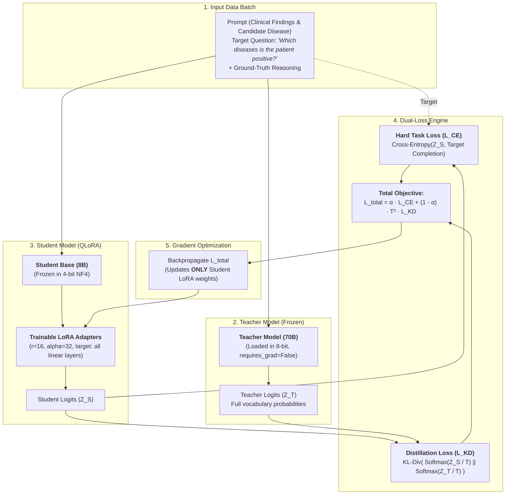

# Clinical LLM Knowledge Distillation & QLoRA Fine-Tuning Guide

This guide documents the implementation of the **Online Knowledge Distillation + QLoRA** fine-tuning pipeline in this repository.

The pipeline fine-tunes a clinical adjudication model where the instruction is explicitly tailored to answer:
> **"Which diseases is the patient positive?"**

---

## 1. Architecture Overview

The system combines two core optimization methods:
1. **Online Knowledge Distillation (KD):** Transfers reasoning distribution ("dark knowledge") from a large, high-capacity **Teacher model** (e.g. `Meta-Llama-3-70B-Instruct` loaded in 8-bit) to a lightweight **Student model** (`Meta-Llama-3-8B-Instruct`).
2. **QLoRA:** Compresses the Student base model into **4-bit NormalFloat (NF4)** and attaches 16-bit LoRA adapters (targeting attention and MLP projection layers). Only the Student's LoRA adapter parameters are updated during backpropagation.



---

## 2. Dataset & Prompt Design

The dataset is loaded directly from [`gt_reasoning/output_gt_reasoning/ground_truth_reasoning_all.jsonl`](gt_reasoning/output_gt_reasoning/ground_truth_reasoning_all.jsonl) (5,308 clinical cases across 15 infectious diseases).

### Prompt Construction
The prompt clearly poses the target question:
```text
Instruction: Based on the clinical findings below, answer the following question: Which diseases is the patient positive? Evaluate whether the patient is positive for <Target Disease> using structured, step-by-step clinical reasoning and provide your final determination.

Candidate Target Disease: <Target Disease>

Clinical Findings:
- <Finding 1>
- <Finding 2>
...

Question: Which diseases is the patient positive?
```

### Target Output
The ground truth reasoning directly provides:
1. **Diagnosis & Subtype**: e.g. `Brucellosis (Brucella abortus neurobrucellosis)` or `OUT_OF_SCOPE (Felty syndrome ... — Not Brucellosis)`.
2. **Step-by-step Clinical Rationale**: numbered synthesis of laboratory, microbiological, and clinical evidence.
3. **Final Adjudication**: `-> POSITIVE diagnosis confirmed.` or `-> OUT_OF_SCOPE diagnosis confirmed.`.

---

## 3. Files in This Implementation

| File | Description |
| :--- | :--- |
| [`requirements.txt`](requirements.txt) | Dependencies (`torch`, `transformers`, `peft`, `trl`, `bitsandbytes`, `datasets`, `accelerate`). |
| [`dataset_loader.py`](dataset_loader.py) | Self-contained dataset loader supporting both **ChatML** and **Alpaca** formats with the question *"Which diseases is the patient positive?"*. Also supports paired raw case pools. |
| [`train_distill_qlora.py`](train_distill_qlora.py) | End-to-end training pipeline with `QLoRADistillationTrainer`, completion loss masking, 4-bit NF4 Student, 8-bit Teacher, and LoRA adapters. Supports `--no_teacher` mode for single GPU training. |
| [`inference_distill_qlora.py`](inference_distill_qlora.py) | Inference script loading 4-bit base model + LoRA adapter, executing test cases with the target question, and printing step-by-step reasoning. |
| [`test_distill_pipeline.py`](test_distill_pipeline.py) | Test suite validating prompt formatting, data loading, and mathematical loss formulation ($T^2 \cdot \text{KL}$ scaling and completion masking). |

---

## 4. How to Run

### 4.1 Install Dependencies
```bash
pip install -r requirements.txt
```

### 4.2 Verify Data & Formats (Dry Run)
You can inspect prompt formatting and verify the question without loading large models:
```bash
# ChatML format (default)
python3 train_distill_qlora.py --dry_run --max_samples 1

# Alpaca format
python3 train_distill_qlora.py --dry_run --max_samples 1 --format_type alpaca
```

### 4.3 Run Training

#### Mode A: Full Knowledge Distillation (Teacher 70B in 8-bit + Student 8B in 4-bit LoRA)
Recommended for multi-GPU or 80GB GPU (A100 / H100):
```bash
python3 train_distill_qlora.py \
    --teacher_model meta-llama/Meta-Llama-3-70B-Instruct \
    --student_model meta-llama/Meta-Llama-3-8B-Instruct \
    --alpha 0.5 \
    --temperature 2.0 \
    --batch_size 1 \
    --gradient_accumulation_steps 16 \
    --epochs 3 \
    --output_dir ./qlora_distilled_output
```

#### Mode B: Student-Only QLoRA (Single Consumer GPU / Lower VRAM)
If running on hardware that cannot fit the 70B teacher simultaneously (e.g. 16GB–24GB GPU):
```bash
python3 train_distill_qlora.py \
    --no_teacher \
    --student_model meta-llama/Meta-Llama-3-8B-Instruct \
    --batch_size 1 \
    --gradient_accumulation_steps 16 \
    --epochs 3 \
    --output_dir ./qlora_distilled_output
```

---

## 5. Running Inference

Evaluate a test case using the trained LoRA adapter:

```bash
# Evaluate sample #30 from dataset
python3 inference_distill_qlora.py \
    --adapter_path ./qlora_distilled_output/final_adapter \
    --sample_index 30

# Custom clinical findings
python3 inference_distill_qlora.py \
    --adapter_path ./qlora_distilled_output/final_adapter \
    --disease "COVID-19" \
    --findings "- Patient presented with dry cough and hypoxemia.\n- RT-PCR from nasopharyngeal swab positive for SARS-CoV-2."
```

Preview inference prompt formatting with `--dry_run`:
```bash
python3 inference_distill_qlora.py --dry_run --sample_index 0
```
