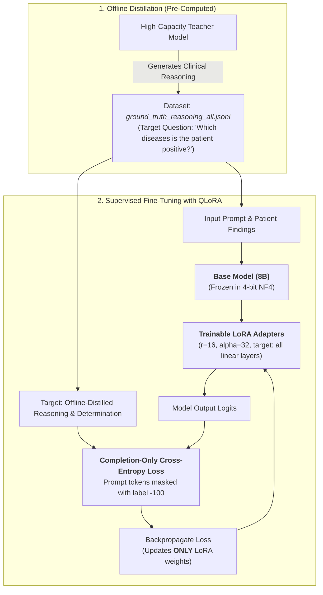

# Clinical LLM Supervised Fine-Tuning (QLoRA) Guide

This guide documents the implementation of the **Supervised Fine-Tuning (SFT) using QLoRA** pipeline in this repository.

The pipeline fine-tunes a clinical adjudication model on offline-distilled reasoning where the instruction is explicitly tailored to answer:
> **"Which diseases is the patient positive?"**

---

## 1. Architectural Transition: Offline Distillation + QLoRA SFT

### Why Online Distillation was Replaced
Online knowledge distillation requires holding both a massive Teacher model (e.g. `Meta-Llama-3-70B-Instruct` in 8-bit, requiring ~70GB+ VRAM) and the Student model (`Meta-Llama-3-8B-Instruct`) in GPU memory simultaneously to calculate dynamic KL divergence losses. This is resource-prohibitive and computationally inefficient.

### The Offline Distillation Solution
**Offline distillation has already been executed beforehand** to generate the gold-standard reasoning in our dataset:
* The high-capacity model adjudicated clinical findings and generated structured, step-by-step rationale for all 5,308 cases in [`gt_reasoning/output_gt_reasoning/ground_truth_reasoning_all.jsonl`](../gt_reasoning/output_gt_reasoning/ground_truth_reasoning_all.jsonl).
* Consequently, the online teacher and soft KL divergence loss are eliminated.
* We perform **Supervised Fine-Tuning (SFT) using QLoRA** directly on this high-quality offline-distilled dataset.



---

## 2. Dataset & Prompt Design

The dataset is loaded directly from [`gt_reasoning/output_gt_reasoning/ground_truth_reasoning_all.jsonl`](../gt_reasoning/output_gt_reasoning/ground_truth_reasoning_all.jsonl) (5,308 clinical cases across 15 infectious diseases).

### Prompt Construction
The prompt clearly poses the target question:
```text
Instruction: Based on the clinical findings below, answer the question: Which diseases is the patient positive?
State the diagnosis, provide your step-by-step clinical reasoning, and give your final diagnostic determination.

Candidate Target Disease: <Target Disease>

Clinical Findings:
- <Finding 1>
- <Finding 2>
...

Question: Which diseases is the patient positive?
```

### Target Output (Offline-Distilled Ground Truth)
The ground truth reasoning directly provides:
1. **Diagnosis & Subtype**: e.g. `Brucellosis (Brucella abortus / Brucella melitensis infection)`.
2. **Step-by-step Clinical Rationale**: numbered synthesis of laboratory, microbiological, and clinical evidence.
3. **Final Diagnostic Determination**: `-> POSITIVE diagnosis confirmed.` or `-> OUT_OF_SCOPE diagnosis confirmed.`.

---

## 3. Files in This Implementation

| File | Description |
| :--- | :--- |
| [`requirements.txt`](../requirements.txt) | Dependencies (`torch`, `transformers`, `peft`, `trl`, `bitsandbytes`, `datasets`, `accelerate`). |
| [`dataset_loader.py`](../dataset_loader.py) | Self-contained dataset loader supporting **ChatML** and **Alpaca** formats with the question *"Which diseases is the patient positive?"*. |
| [`train_qlora.py`](../train_qlora.py) | Production-ready Supervised Fine-Tuning pipeline using QLoRA with TRL `SFTTrainer` (4-bit NF4, LoRA adapters, completion loss masking via `DataCollatorForCompletionOnlyLM`). |
| [`inference_qlora.py`](../inference_qlora.py) | Inference script loading 4-bit base model + LoRA adapter, evaluating test cases with the target question. |
| [`test_qlora_pipeline.py`](../test_qlora_pipeline.py) | Unit test suite validating prompt formatting, dataset loading, and completion-only Cross-Entropy loss masking. |
| [`evaluate_model.py`](../evaluate_model.py) | Comprehensive evaluation suite reporting Accuracy, Sensitivity, Specificity, F1, and ROUGE-1/2/L text quality. |

---

## 4. How to Run

### 4.1 Install Dependencies
```bash
pip install -r requirements.txt
```

### 4.2 Verify Data & Formats (Dry Run)
You can inspect prompt formatting and verify the question without downloading large models:
```bash
# ChatML format (default)
python3 train_qlora.py --dry_run --max_samples 1

# Alpaca format
python3 train_qlora.py --dry_run --max_samples 1 --format_type alpaca
```

### 4.3 Run Supervised Fine-Tuning (QLoRA)
Trains the 8B model with 4-bit quantization and LoRA adapters on a single GPU (requires ~8–12 GB VRAM):
```bash
python3 train_qlora.py \
    --model_name_or_path meta-llama/Meta-Llama-3-8B-Instruct \
    --gt_file gt_reasoning/output_gt_reasoning/ground_truth_reasoning_all.jsonl \
    --format_type chatml \
    --question_text "Which diseases is the patient positive?" \
    --batch_size 1 \
    --gradient_accumulation_steps 16 \
    --learning_rate 2e-4 \
    --epochs 3 \
    --output_dir ./qlora_sft_output
```

---

## 5. Running Inference & Evaluation

### 5.1 Single-Case Inference
Evaluate a test case using the trained LoRA adapter:
```bash
# Evaluate sample #30 from dataset
python3 inference_qlora.py \
    --adapter_path ./qlora_sft_output/final_adapter \
    --sample_index 30

# Custom clinical findings
python3 inference_qlora.py \
    --adapter_path ./qlora_sft_output/final_adapter \
    --disease "COVID-19" \
    --findings "- Patient presented with dry cough and hypoxemia.\n- RT-PCR from nasopharyngeal swab positive for SARS-CoV-2."
```

Preview inference prompt formatting with `--dry_run`:
```bash
python3 inference_qlora.py --dry_run --sample_index 0
```

### 5.2 Comparative Evaluation (Disease Name + Step-by-Step Reason)
Evaluates and compares both models side-by-side on the held-out test split across the full clinical fine-tuning objective (**Disease Name, Etiologic Subtype, and Step-by-Step Clinical Reasoning**):
* **Disease Identification**: Disease name accuracy, header positioning, and specific pathogen/etiology detection.
* **Clinical Reasoning Quality**: Structured reasoning rate (`Reasoning: (1)...`), clinical claim coverage, and ROUGE-1/2/L text overlap.
* **Joint Diagnostic Success**: Measures complete diagnostic success (Disease Name + Structured Rationale + Confirmation).
* **Case-Level Adjudication Transitions**: Quantifies Wins (`FT_IMPROVED`), Regressions (`FT_REGRESSED`), and Net Diagnostic Gain.
```bash
# Head-to-Head Comparison Mode
python3 evaluate_model.py \
    --eval_mode compare \
    --base_model meta-llama/Meta-Llama-3-8B-Instruct \
    --adapter_path ./qlora_sft_output/final_adapter \
    --test_ratio 0.15 \
    --output_dir ./eval_results

# Validate comparison logic without GPU
python3 evaluate_model.py --dry_run --max_samples 10
```
