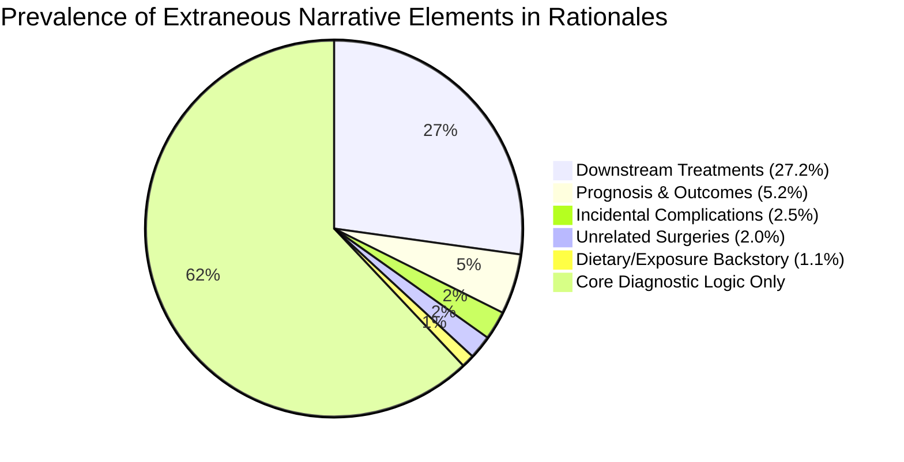

# Rationale Narrative Content Analysis: Extraneous Clinical Details

This document compiles the evidence and breakdown of auxiliary narrative information and non-diagnostic clinical details identified across **7,043 labeled rationales** in `workspace/labeled_pool/output`.

---

## 1. Executive Summary

An evaluation of the clinical rationales indicates that the **underlying diagnostic logic is sound and intact**: the annotations correctly verify target pathogen laboratory confirmation, temporality (`CURRENT_EPISODE`), and protocol adjudication (`POSITIVE`, `NEGATIVE`, `EXCLUDED`).

However, approximately **27% to 35%** of the rationales include incidental clinical narrative details that were carried over from the source case reports. While not invalidating the diagnosis, these details represent non-diagnostic narrative content.

---

## 2. Identified Categories of Extraneous Information

---

### Category 1: Downstream Treatments & Specific Drug Regimens (1,916 cases, ~27.2%)
* **Clinical Context:** A disease claim is established upon diagnostic presentation and laboratory confirmation. Recording post-diagnostic therapeutic interventions and antibiotic regimens is not required to justify the diagnosis.
* **Examples from Dataset:**
  * **Brucellosis (`output_brucellosis.jsonl`):**
    > *"...Agglutination titers were markedly elevated for B. abortus (1:5,120)... **and the patient fully recovered after doxycycline and rifampin**."*
  * **Dengue (`output_dengue.jsonl`):**
    > *"...Follow-up diagnostic testing demonstrated positive IgM serology for dengue... **successfully treated with IVIG and prednisolone**."*
  * **Leishmaniasis (`output_leishmaniasis.jsonl`):**
    > *"...Blood mNGS detected Leishmania infantum... **after sodium stibogluconate treatment with spleen regression**."*

---

### Category 2: Post-Admission Course, ICU Stays, & Discharge Outcomes (364 cases, ~5.2%)
* **Clinical Context:** Inpatient duration, mechanical ventilation days, and rehabilitation courses reflect prognosis and disease severity rather than the factual presence or absence of the target condition.
* **Examples from Dataset:**
  * **COVID-19 (`output_covid_19.jsonl`):**
    > *"...SARS-CoV-2 was confirmed by RT-PCR... **She suffered critical ARDS requiring 49 days of ICU care, mechanical ventilation, and tracheostomy, before entering a home-based exercise rehabilitation program post-discharge**."*
  * **Chikungunya (`output_chikungunya.jsonl`):**
    > *"...fever, arthralgia, and **severe hemorrhagic bullous lesions requiring ICU care**..."*

---

### Category 3: Unrelated Surgical Interventions (143 cases, ~2.0%)
* **Clinical Context:** Surgical interventions performed for secondary anatomical complaints or incidental pre-operative findings are included alongside the primary infectious disease claim.
* **Examples from Dataset:**
  * **HIV/AIDS (`output_hiv_aids.jsonl`):**
    > *"A 54-year-old woman presented with painful restriction of knee motion **18 months following total knee arthroplasty due to patella infera and patellar ligament shortening... The patient underwent successful revision surgery.** During pre-operative diagnostic testing, an HIV infection was detected for the first time..."*  
    *(The knee arthroplasty and revision surgery are incidental to the newly discovered HIV diagnosis).*

---

### Category 4: Secondary Complications & Incidental Rare Sequelae (174 cases, ~2.5%)
* **Clinical Context:** Rare autoimmune reactions or secondary tissue necrosis occurring downstream of the infection are noted in the rationale.
* **Examples from Dataset:**
  * **Brucellosis (`output_brucellosis.jsonl`):**
    > *"...Serology was positive for Brucella abortus, **followed by secondary P-ANCA vasculitis**."*
  * **Dengue (`output_dengue.jsonl`):**
    > *"...The patient **developed secondary autoimmune bicytopenia (Evans syndrome) with positive Coombs test**..."*

---

### Category 5: Extraneous Dietary / Exposure Backstories (78 cases, ~1.1%)
* **Clinical Context:** Patient lifestyle anecdotes and ingestion histories add descriptive context but do not replace objective laboratory criteria.
* **Examples from Dataset:**
  * **Brucellosis (`output_brucellosis.jsonl`):**
    > *"A 9-year-old male **with unpasteurized goat milk ingestion** presented with..."*
  * **Cholera (`output_cholera.jsonl`):**
    > *"A 25-year-old male presented with diarrhea **following raw mollusc ingestion**..."*

---

## 3. Impact Assessment for QLoRA Fine-Tuning

| Factor | Assessment | Practical Implication |
| :--- | :--- | :--- |
| **Diagnostic Validity** | **High** | The clinical decisions (`POSITIVE`, `NEGATIVE`, `EXCLUDED`) and laboratory evidence grounding are accurate. |
| **Generalizability** | **High** | The model is not constrained by false negative rules; it learns the legitimate diagnostic boundaries. |
| **Output Length** | **Moderate Increase** | Extra narrative clauses increase the target token length by ~20–35%. |
| **Readiness for Training** | **Ready As-Is** | The dataset can be used directly for fine-tuning without manual curation. |
